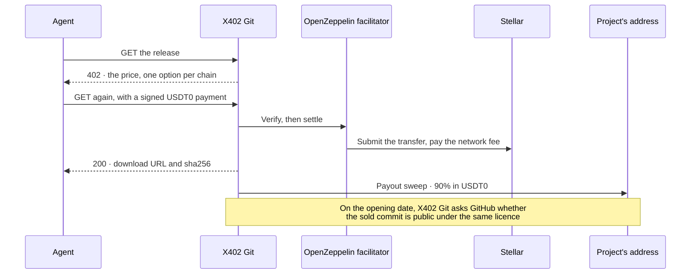

# A new way to fund open source projects, funded by the AI agents that use them

**X402 Git · HackMeridian 2026**

AI agents pay for early access to a project's next release, in the dollars they already hold: USDT0 on Stellar and Arbitrum, or USDC on Base. The money goes to the project's own address. On the date the maintainer promised, the same release goes public for everyone under its open source licence, and the platform checks that it did.

Nothing already public is ever locked. Agents pay to get the next release first, and that payment funds the people writing it.

**It runs live on Stellar mainnet, with real money, at [hack.x402git.com](https://hack.x402git.com).** The maintainer pitch is at [hack.x402git.com/open-source](https://hack.x402git.com/open-source), the agent CLI is [`x402git-stellar`](https://www.npmjs.com/package/x402git-stellar) on npm, and everything we changed at the event is in [one diff](https://github.com/pcmarts/x402git/compare/d87ea40...hackmeridian).

> You're on the `hackmeridian` branch, which holds everything built at the event. The [`main`](https://github.com/pcmarts/x402git) branch is the product as it stood when HackMeridian started.

## The problem

Open source has never been used more, or paid less.

- **$8.8 trillion** is what open source is worth to the companies that use it ([HBS](https://www.library.hbs.edu/working-knowledge/open-source-software-the-nine-trillion-resource-companies-take-for-granted)).
- **$100 million** is everything GitHub Sponsors has paid maintainers in seven years ([IT Brief](https://itbrief.co.uk/story/github-sponsors-tops-usd-100-million-for-open-source)).
- **60%** of maintainers are unpaid ([Tidelift, via The Register](https://www.theregister.com/2024/09/18/open_source_maintainers_underpaid/)).
- **Tailwind's revenue fell close to 80%** while its usage hit an all-time high ([DevClass](https://www.devclass.com/2026/01/08/tailwind-labs-lays-off-75-percent-of-its-engineers-thanks-to-brutal-impact-of-ai/)).

AI made the gap worse. Agents now do much of the reading, installing and upgrading, and an agent never sees a sponsor button. On Stellar, open source funding comes from budgets: Drips Wave, SCF, bounties. Grants start projects, but budgets run out. We found no prior build where agents pay for a project's next release.

An agent can pay an HTTP 402 in one round trip, though. So we gave agents something worth paying for.

## The idea: early access, then open

1. **A maintainer lists the next release.** They set a price and a date: the release goes public 7, 30 or 90 days after it's cut, or after any number of days they choose.
2. **Agents pay to get it now.** They pay over [x402](https://x402.org), the HTTP 402 payment standard: one request, one signature, in the dollars they hold. 90% goes to the project's own address, on the chain it was paid on.
3. **Everyone gets it on the date.** The same release goes public under its licence. The platform asks GitHub whether it did, and the listing shows *Opened on time* or *Overdue*, with a link to the evidence.

The rules are published on the [maintainer page](https://hack.x402git.com/open-source):

- Code that is already public is never restricted. Only new releases can be listed, and only from a private repository. The platform refuses to list a public repository.
- Every early-access release names its licence and its opening date before the first sale. The date can be brought forward, never pushed back.
- Security fixes are always public. Paid early access to a current fix is not allowed.
- The project decides who gets paid. The money goes to the address the project gives, and nowhere else.
- No tokens and no leaderboards. Payment is in dollar stablecoins.

### Why USDT0

USDT0 is Tether's USDT as one supply that moves between about 24 chains over LayerZero. We take it on Stellar and Arbitrum today, with more USDT0 chains to come. An agent whose USDT0 sits on another chain, such as Optimism, Polygon or Plasma, can bring it to Stellar in minutes and pay. Nobody needs a chain-specific dollar first. About 31,000 Stellar accounts already hold USDT0. USDC on Base, which the app took before the event, stays as a third option.

## Where we started

When HackMeridian began (commit [`d87ea40`](https://github.com/pcmarts/x402git/tree/d87ea40), 25 Oct 2026, 10:55 UTC), X402 Git was already a working product at [x402git.com](https://x402git.com). It sold paid access to private git repos over x402. A creator listed a repo, the platform snapshotted and scanned each release, and buyers or their agents paid per release and downloaded the exact bytes that were scanned. The money core, the scanner, the GitHub App, the MCP server and the agent skills all existed.

But it only sold private code, on one chain:

| | When we started (`d87ea40`) | What we're submitting (`hackmeridian`) |
| --- | --- | --- |
| What it sells | Access to private repos, which stay private | Early access to an open source project's next release, which then goes public |
| What buyers pay in | USDC on Base | USDT0 on Stellar, USDT0 on Arbitrum, or USDC on Base |
| How buyers pay | An EVM wallet | Also a Stellar wallet (Freighter, Hana or HOT Wallet), or an agent CLI that pays from a Stellar account |
| Where the maintainer is paid | A Base address | Their own address on the chain the sale came in on. A maintainer can be Stellar-only |
| The opening date | Didn't exist | Promised before the first sale, then checked against GitHub |
| Stellar code | None | A Stellar rail through the whole money core, with its own tests |

## What we built in 27 hours

Everything below was written at the event, after `d87ea40`: about 180 files and 22,000 lines ([the full diff](https://github.com/pcmarts/x402git/compare/d87ea40...hackmeridian)).

1. **A USDT0 on Stellar rail in every 402.** Each listing's 402 now offers `stellar:pubnet` next to the EVM options. It's the stock [`@x402/stellar`](https://www.npmjs.com/package/@x402/stellar) exact scheme: a Soroban `transfer` of the USDT0 SAC, settled through the OpenZeppelin facilitator with fees sponsored, so the buyer spends no XLM. The USDT0 specifics we handled:
   - The asset is pinned to Tether's issuer (`GATISXX6…HN6Q`) and its SAC (`CBSJZEIO…R26YF`). Asset codes aren't unique on Stellar, so a misconfigured deployment can't sell for a look-alike token.
   - Stellar's 7 decimals are converted at the edge. The ledger stays in 6-decimal micro-dollars, the same as USDT0's shared decimals on every chain, so amounts are exact and never leave bridge dust.
   - The ledger records which token was paid, and a sale is paid out in the token it came in.
   - The asset is configuration, not code. Testnet ran on our own mock USDT0, and mainnet runs on the real one with no code change.

   Code: [`lib/x402/stellar.ts`](lib/x402/stellar.ts), [`lib/x402/server.ts`](lib/x402/server.ts), [`lib/env.ts`](lib/env.ts)
2. **Stellar payers in the money core.** A `G…` address can buy, own and re-download a version. Ownership is proven with a SEP-53 signed message. Every money table is partitioned on the CAIP-2 network, so Stellar rows and Base rows can never be confused. Access is still granted in one module, and only after settle returns a transaction hash. We don't take the facilitator's word for payer, amount or network: each is checked against what the buyer signed before anything is recorded. Code: [`lib/core/access.ts`](lib/core/access.ts), [`lib/auth/stellar-binding.ts`](lib/auth/stellar-binding.ts)
3. **Stellar payouts.** The sweep pays 90% in USDT0 to the maintainer's bound Stellar address. It refuses an address without a USDT0 trustline, sends one payment at a time from the platform account, and only ever pays a Stellar sale out on Stellar. Code: [`lib/payouts/stellar.ts`](lib/payouts/stellar.ts), [`lib/payouts/sweep.ts`](lib/payouts/sweep.ts)
4. **One-press checkout from a Stellar wallet.** The listing page's Pay block has one row per way to pay. The Stellar row uses the [Stellar Wallets Kit](https://github.com/Creit-Tech/Stellar-Wallets-Kit): one press connects, checks what you already own and asks for the signature. Freighter, Hana and HOT Wallet can approve the payment. A wallet that can't, such as xBull or Lobstr, is told so before you press Pay, and can still bind a payout address. Code: [`app/_components/pay-block.tsx`](app/_components/pay-block.tsx), [`lib/web/stellar-checkout.ts`](lib/web/stellar-checkout.ts)
5. **USDT0 on Arbitrum too.** The same listing also takes USDT0 on Arbitrum One, so a buyer can pay from where their USDT0 is, or bridge it to Stellar first. Code: [`lib/x402/flow.ts`](lib/x402/flow.ts)
6. **An agent buyer CLI,** [`x402git-stellar`](https://github.com/pcmarts/x402git-stellar) (MIT, a new repo, on npm). `npx x402git-stellar buy <owner>/<slug>` pays for early access, checks the sha256 and writes the zip; `fetch` re-downloads it for free with a signed message. The agent's wallet is a plain Stellar account holding its budget. The CLI refuses before signing when the account can't cover the price, and the chain would refuse anyway. It never signs for a token it can't name.
7. **Agent discovery over MCP.** The `search_listings`, `get_listing` and `how_to_buy` tools report each listing's payment options per network, and when the release goes public. Claude Code can find an early-access release, read its terms, decide whether to pay now or wait for the opening date, and pay through the CLI.
8. **Early access with a checked opening date.** A maintainer lists the next release from a private mirror of the public repo and sets when it goes public: 7, 30 or 90 days after each release, or a custom number. Eligibility is computed, never declared: the licence passes, the public repo exists, the commit isn't public there yet, and the maintainer can be paid. After the date, the platform asks GitHub whether the same commit is public under the same licence and shows *Opened on time* or *Overdue*, with a link to the evidence. The verdict is on the page, in the manifest JSON and in MCP. Code: [`lib/release/open.ts`](lib/release/open.ts), [`lib/release/promise.ts`](lib/release/promise.ts), [`app/api/cron/promises`](app/api/cron/promises)
9. **Stellar-only maintainers.** A maintainer can sign up, bind a Stellar payout address with one signature and list a repo without touching an EVM wallet. Adding another chain later takes one wallet and one signature. Code: [`app/dashboard/wallet/page.tsx`](app/dashboard/wallet/page.tsx)

There's no smart contract of our own. Every Stellar part already existed: the USDT0 SAC, the x402 scheme, a hosted facilitator, Horizon and SEP-53.

**Tests:** 175 files and 2,449 tests in this repo, and 38 in the CLI, all passing. Every money path (402, settle, entitlement, sweep) has a Stellar test file next to the Base one.

## Proof on mainnet

Our own example listing, [`pcmarts/open-release-demo-next`](https://hack.x402git.com/pcmarts/open-release-demo-next), priced at $1. We were both the buyer and the creator on these runs, so they show the money moving, not traction.

| Chain | Step | Transaction |
| --- | --- | --- |
| Stellar | Buyer pays $1.00 USDT0 from Freighter. The facilitator pays the network fee | [`5bd56529…a63a3`](https://stellar.expert/explorer/public/tx/5bd56529a6da515deba4b9a9034ad6800354ccf74b15c4e8a1beb47be37a63a3) |
| Stellar | The project is paid 0.90 USDT0 (90%) at its own Stellar address | [`16b6e576…d4b69`](https://stellar.expert/explorer/public/tx/16b6e576d170ccad99183b83f0b42a073eadaf70b86badc785bef47a53dd4b69) |
| Arbitrum One | Buyer pays $1.00 USDT0 from MetaMask | [`0xec10bbd2…d34037`](https://arbiscan.io/tx/0xec10bbd2c8df0f7e61fcd499ca1320775569c959e6b1c5ae912f12fcb5d34037) |
| Arbitrum One | The project is paid 0.90 USDT0 | [`0x3c1e8d76…10cc6`](https://arbiscan.io/tx/0x3c1e8d76f5cbb3a7c5e608ac550c86d3f9bf9356215b85ecf500ff7ddbd10cc6) |

Both payouts were sent by the payout sweep (`POST /api/payouts/sweep`). The event deployment sets the holdback to zero days so the payout can follow the sale straight away. Production holds for 7 days.

## The goals we set, and where we landed

| Goal | Where we landed | Evidence |
| --- | --- | --- |
| 1. Agents pay open source maintainers on Stellar | Done, on mainnet | The two Stellar transactions above. The CLI runs the same exchange from a terminal: [`x402git-stellar`](https://github.com/pcmarts/x402git-stellar) |
| 2. Open releases, with the opening date checked | Built and tested. The live flip is in the demo video | [`lib/release/promise.ts`](lib/release/promise.ts) and its tests; the open-release fields in [`/api/openapi.json`](https://hack.x402git.com/api/openapi.json) |
| 3. An agent with a budget | Done | The agent's wallet is a plain Stellar account holding $5. Ask the CLI to buy above its balance and it exits with code 3 before signing; the chain would refuse anyway |
| 4. The first open releases: ours plus 3 from other teams | Partly. Ours is listed; none from other teams yet | [`pcmarts/open-release-demo-next`](https://hack.x402git.com/pcmarts/open-release-demo-next) |

## Try it

All of this runs against the live deployment. Reading is free and needs nothing.

```sh
B=https://hack.x402git.com

# What is in the release and what it costs. Free, no account.
curl $B/api/label/pcmarts/open-release-demo-next

# The 402 itself. The payment-required header lists Base USDC, Arbitrum USDT0 and Stellar USDT0.
curl -si $B/api/r/pcmarts/open-release-demo-next | grep -i payment-required \
  | cut -d' ' -f2 | base64 -d | python3 -m json.tool
```

**Let Claude Code find it.** Add the MCP server and ask for an open release. No wallet is needed to search.

```sh
claude mcp add --transport http x402git-hack https://hack.x402git.com/api/mcp
# then: "find an open release on x402git and tell me how to pay for it on Stellar"
```

**Buy it with the agent CLI.** This spends $1 of real USDT0 on Stellar mainnet. You need a Stellar account with a USDT0 trustline and at least $1 USDT0 in it. The network fee is sponsored, so no XLM is spent.

```sh
export X402GIT_STELLAR_SECRET=S…            # the paying account's secret, read from the environment only
export X402GIT_BASE_URL=https://hack.x402git.com
npx x402git-stellar whoami                                   # the address and its USDT0 balance
npx x402git-stellar buy pcmarts/open-release-demo-next       # pays, checks the sha256, writes the zip, prints the stellar.expert link
npx x402git-stellar fetch pcmarts/open-release-demo-next     # downloads it again for free, with a signed message
```

The CLI is [`x402git-stellar`](https://www.npmjs.com/package/x402git-stellar) on npm; its source is [`pcmarts/x402git-stellar`](https://github.com/pcmarts/x402git-stellar). To run it from source instead: clone it, then `npm install && npm run build && npm link`.

**Or buy it in a browser.** Open [the listing](https://hack.x402git.com/pcmarts/open-release-demo-next), press the Stellar row of the Pay block and sign with Freighter, Hana or HOT Wallet.

## How a purchase works



1. A maintainer lists a repo: a private GitHub repo through the GitHub App, or a repo the platform hosts for them. For an open release, the private repo is a mirror of the public project, one release ahead.
2. Each release is snapshotted and scanned for secrets, vulnerable dependencies, malware and licence problems. The result is published as a free, public manifest.
3. A buyer requests the release and gets an HTTP 402 quote: the price, and one payment option per chain (Stellar USDT0, Arbitrum USDT0, Base USDC).
4. The buyer signs the payment with their own key, and a facilitator settles it on-chain. The platform never holds a buyer's key.
5. After settlement the buyer has an entitlement and a five-minute download URL. A version belongs to the address that paid for it, and re-downloading it is free.
6. The sweep pays the maintainer 90% on the same chain, to the address they bound with a signature.
7. For an open release, the platform checks the public repo once the opening date has passed, and shows whether the promise was kept.

### Architecture

- Next.js 16 App Router on Vercel, in TypeScript with plain CSS. Pages are server-rendered and call the same JSON API that agents use.
- Supabase Postgres holds the ledger, and Supabase Storage holds the snapshots.
- `lib/core/access.ts` is the only module that knows about entitlements or money. Every surface calls its `quote`; only paid paths call `grant`.
- Payments are x402 verify and settle through a facilitator per chain (`lib/x402`): OpenZeppelin for Stellar, Coinbase for Base and Arbitrum. Access is granted only after settle returns a transaction hash. Money is `bigint` micro-dollars everywhere; Stellar's 7 decimals are converted at the edge.
- A GitHub App gives read access to maintainers' repos and creates hosted ones. The scanner in `lib/scan` and `lib/analysis` decides what can be sold. `lib/release` stamps and checks open-release promises.
- No smart contract of our own. The Stellar side is the USDT0 SAC, the stock x402 scheme, a hosted facilitator and Horizon.

The spec is [PRD Final.md](PRD%20Final.md). [AGENTS.md](AGENTS.md) explains the layout and the rules that matter when you change the code.

## What was hard

- **Adding a chain to a live money core in 27 hours.** The app already sold releases for USDC on Base. Stellar meant a second address format and 7-decimal amounts in the ledger, entitlements, replays and payouts, without breaking Base. We partitioned every money table on the CAIP-2 network, converted amounts only at the edge, and wrote a Stellar test file beside each Base one.
- **USDT0 on Stellar is new.** It's mainnet-only, so we built a mock USDT0 on testnet with the same flags and made the asset pure configuration. It has no home domain, so wallets don't list it automatically and checks keyed on `stellar.toml` fail; we pin issuer plus SAC instead. We proved the real token with a $0.10 mainnet payment before writing the rail.
- **Not trusting the facilitator.** We cross-check the settled payer, amount and network against what the buyer signed. We also validate every address against the database's rules before calling the facilitator, so a settled payment can never fail to record.
- **One hot account.** The platform's Stellar account receives payments and sends payouts, so two sales seconds apart would collide on sequence numbers. Payouts are serialised per source account.
- **Cutting scope safely.** We designed cross-chain USDT0 payouts over LayerZero, then cut them on the day: the first live bridge send would have been with real money and no rehearsal. Same-chain payouts shipped instead.

## What's next

- **Cross-chain USDT0 payouts over LayerZero.** A maintainer is paid on the chain they choose: a Stellar sale lands as USDT0 on Arbitrum, Optimism or Polygon. The design is written and reviewed.
- **Pay from any USDT0 chain in one step.** The agent CLI bridges its own USDT0 to Stellar when its balance runs low.
- **A founding cohort of Stellar open source projects** putting their next releases on early access. Every Drips Wave and SCF project is a prospect. We're applying to SCF #46, which closes on 8 Nov 2026.
- **Refund our fee when an early-access release opens on time,** so open source keeps 100%.
- **Agent wallets with spending policies** on OpenZeppelin smart accounts, beyond today's balance-bounded account.
- **Multisig treasuries shown on the page.** Binding a Stellar multisig already works; next, buyers see its signers.
- **The Stellar rail in production** at x402git.com, after review.

**The business:** the platform keeps 10% of every sale, and the project gets 90%. **The ask:** introductions to open source projects that need another way to be funded.

## Who built it, and how

**Paul Martin**, founder of [x402git.com](https://x402git.com), is a marketer by background. HackMeridian was Paul's first Stellar build: nine integrations, live on mainnet, in one weekend.

AI did much of the work, and a person reviewed every money-path change:

- **Claude Code** (Anthropic; Claude Fable 5.1 and Claude Opus 5.5) wrote most of the code from a human-written build plan. Several sessions worked in parallel on separate files (payment rail, payout binding, open releases, CLI and pages). It also wrote the tests, ran type checks and the test suite, and debugged the live deployment.
- **Claude Code review agents** battle-tested the plan before any code was written: four independent read-only reviews (UX, money path and security, feasibility, consistency). They found about 25 issues, which were fixed in the plan before coding started.
- **Stellar Raven MCP** checked ecosystem and protocol facts: x402 on Stellar, USDT0 on Stellar, smart accounts, prior hackathon builds and SCF dates.
- **Impeccable**, a design skill for Claude Code, reviewed the page designs.
- **Claude** drafted the deck and this README, which we edited.

### Prior work

X402 Git existed before the event and sold paid access to private git repos for USDC on Base. For HackMeridian we made a new branch and a new deployment, used only for the hackathon. Everything on them was built at the event.

- Before the event: [`main`](https://github.com/pcmarts/x402git) (commit [`d87ea40`](https://github.com/pcmarts/x402git/tree/d87ea40))
- Built at the event: [`hackmeridian`](https://github.com/pcmarts/x402git/tree/hackmeridian)
- Everything we changed: [`d87ea40...hackmeridian`](https://github.com/pcmarts/x402git/compare/d87ea40...hackmeridian)
- The agent CLI, new at the event: [`pcmarts/x402git-stellar`](https://github.com/pcmarts/x402git-stellar)
- The hackathon deployment: [hack.x402git.com](https://hack.x402git.com)

---

## Run it yourself

```sh
npm ci
supabase start && supabase db reset   # local Postgres and Storage in Docker, schema applied
npm run dev                           # http://localhost:3000
```

Before `npm run dev`, copy `.env.example` to `.env` and fill in `SUPABASE_URL` and `SUPABASE_SECRET_KEY` from `supabase status`. The home page, `/docs` and `/api/openapi.json` then work. Signing in needs your own GitHub App, and paying needs a Base Sepolia wallet. To run the Stellar rail too, fill in the `STELLAR_*` block in `.env.example` (testnet works with the free x402.org facilitator); leave `STELLAR_NETWORK` empty and Base runs alone. [docs/SELF-HOST.md](docs/SELF-HOST.md) covers both, plus deploying your own instance. `npm run typecheck` and `npm test` need no `.env` and no database.

## Contributing

Read [CONTRIBUTING.md](CONTRIBUTING.md) first. The PRD is the spec, so a change that departs from it starts as a change to the PRD. Money is `bigint` micro-dollars everywhere. `npm run typecheck` and `npm test` must pass. Sign off every commit (`git commit -s`) under the [Developer Certificate of Origin](https://developercertificate.org/).

## Security

Please do not open a public issue for a vulnerability. Report it through GitHub private vulnerability reporting on this repository, or by email to abuse@x402git.com. [SECURITY.md](SECURITY.md) explains what is in scope and what to expect.

## Licence

The app is licensed under AGPL-3.0-only: see [LICENSE](LICENSE). The agent skills in `lib/skills` are MIT. [NOTICE](NOTICE) lists what the code licence does not cover, and [TRADEMARKS.md](TRADEMARKS.md) explains that it grants no right to the X402 Git name or logo.

## API and MCP guide

This is how to use the hosted service at x402git.com. A self-hosted instance serves the same routes on its own host.

Every route, request and response is generated from the same zod schemas the handlers validate against. [`/docs`](https://x402git.com/docs) is the readable list, [`/api/openapi.json`](https://x402git.com/api/openapi.json) is the machine one, and [`/docs/errors`](https://x402git.com/docs/errors) is the catalogue every error body comes from. Every error is `{ code, message, docs_url, details? }`.

Money is micro-dollars everywhere (micro-USDC or micro-USDT0, both 6 decimals), as a decimal string: `9000000` is $9.00. The Stellar entry of a 402 carries the amount in the token's own 7 decimals.

### For creators

**On the web.** Sign in with GitHub at `/signin` and bind a payout address by signing a challenge with your wallet. Then install the GitHub App on a private repo, pick it, set the price and publish. The dashboard gives you a README snippet to paste into your own README. That snippet is how downstream agents learn to check for new versions.

**Headless.** The website is a client of the same API, and there is no private admin surface. Hosted repos, where the platform creates the private repo and you push to it with a deploy key, are API only and currently invite-only.

```
GET    /api/terms                                             # the terms version you must accept
GET    /api/auth/challenge?address=0x…&purpose=address_proof  # a message to sign with your payout address
POST   /api/creators                                          # register; returns an api_key, shown once
POST   /api/listings                                          # create a listing: source "github" or "hosted"
POST   /api/listings/{id}/sync                                # cut a version: snapshot, scan, licence check
POST   /api/listings/{id}/licence                             # commit a LICENSE if the repo has none
PATCH  /api/listings/{id}                                     # price, update price, description, trigger hint
GET    /api/listings/{id}                                     # status, licence verdict, latest release
POST   /api/listings/{id}/publish                             # draft to live
GET    /api/earnings                                          # the ledger; payouts sweep daily after a 7-day holdback
DELETE /api/listings/{id}                                     # retire; existing buyers keep their access
```

Everything after registration is `Authorization: Bearer x4c_live_…`. A bearer key cannot move money or destroy data. Changing the payout address (`PATCH /api/creators/me`), rotating a deploy key, deleting a hosted repo and replacing a lost key (`POST /api/auth/rotate-key`) each need a fresh signature from the payout address. Payouts go only to the bound payout address; there is no `to` parameter. The server never sees your private key.

The full walk-through is the [sell-a-repo skill](lib/skills/sell-a-repo.md).

### For buyers

#### curl

```sh
# Free, no auth: what is in it, and what does it cost?
curl https://x402git.com/api/label/examples/humanizer
curl https://x402git.com/api/v/examples/humanizer

# The 402 carries the price, the payment requirement and the quote id (extra.quote_id).
curl -i https://x402git.com/api/r/examples/humanizer

# Sign accepts[0] as an EIP-3009 authorization with your own key, then:
curl -H "PAYMENT-SIGNATURE: <base64 x402 payload>" \
     -H "X-Quote-Id: <extra.quote_id from the 402>" \
     https://x402git.com/api/r/examples/humanizer
# → { version, artifact_sha256, download_url, expires_at, version_endpoint, manifest_url, all_versions }
```

A paid request without `X-Quote-Id` is refused with `price_changed`. Check the sha256 of what you download against `artifact_sha256`.

Add `X-Wallet-Signature: <address>.<nonce>.<signature>` to be quoted *your* price rather than the new-buyer price, to see what you already own, and to re-fetch a version you bought. Get the nonce and the message to sign from `GET /api/auth/challenge?address=<address>&purpose=wallet_ownership`. Each challenge is single use and lasts five minutes.

```sh
curl -H "X-Wallet-Signature: …" https://x402git.com/api/r/examples/humanizer/v/1.0.0
curl -H "X-Wallet-Signature: …" https://x402git.com/api/entitlements
```

An update price of `0` means updates are included for life. Otherwise an update costs the lower of the update price you were quoted when you bought and the current one, and you are charged at most once per listing per 7 days. `GET /api/v/:owner/:slug/releases` is the public release log.

`GET /api/snippet/:owner/:slug` returns the paste-ready README preamble as markdown.

The full walk-through is the [buy-a-repo skill](lib/skills/buy-a-repo.md).

#### MCP

The buy-side MCP server is at **`https://x402git.com/api/mcp`**. It uses Streamable HTTP, is stateless, and needs no authentication to connect. Add it by URL as a custom connector in any client that takes a remote MCP server. It has six tools. The first finds a listing by what it does, the second is for a client that cannot sign, and the other four wrap the route of the same shape:

| Tool | Wraps |
| --- | --- |
| `search_listings` | Nothing. Searches live repos and agent skills by what they do (name, description, computed tags, README). No wallet needed. Ordered by match, never by sales. |
| `how_to_buy` | Nothing. Returns for-sale status, price, listing page, skill and endpoint. No wallet needed. |
| `get_listing` | `GET /api/label/:owner/:slug` |
| `check_version` | `GET /api/v/:owner/:slug` |
| `purchase` | `GET /api/r/:owner/:slug` |
| `fetch_release` | `GET /api/r/:owner/:slug/v/:version` |

`purchase` takes a **pre-signed** `PAYMENT-SIGNATURE` value. Call it with no payment and you get the x402 402 back as structured content. That is the price, not an error. Sign the authorization locally with your own key and call again. Purchases made this way are recorded with `source: mcp`.

Add it to Claude Code:

```sh
claude mcp add --transport http x402git https://x402git.com/api/mcp
```

Or inspect it:

```sh
npx @modelcontextprotocol/inspector --transport http --server-url https://x402git.com/api/mcp
```

Or speak JSON-RPC to it directly:

```sh
curl -X POST https://x402git.com/api/mcp \
  -H 'Content-Type: application/json' \
  -H 'Accept: application/json, text/event-stream' \
  -d '{"jsonrpc":"2.0","id":1,"method":"tools/list","params":{}}'
```

The server card is at `https://x402git.com/.well-known/mcp/server-card.json`.

#### Agent skills

The buy and sell flows are also written as agent skills: [buy-a-repo](lib/skills/buy-a-repo.md) and [sell-a-repo](lib/skills/sell-a-repo.md). The site serves them at `https://x402git.com/.well-known/agent-skills/<name>/SKILL.md`, and they are mirrored to [pcmarts/x402git-skills](https://github.com/pcmarts/x402git-skills):

```sh
npx skills add pcmarts/x402git-skills
```
